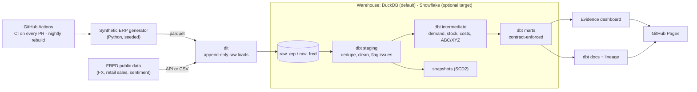

# Craftstones Data Platform: An Ideal-State Redesign

[](https://github.com/orginalbusta/Wholesale-inventory-analytics/actions/workflows/ci.yml)
[](https://github.com/orginalbusta/Wholesale-inventory-analytics/actions/workflows/deploy-pages.yml)

**Live dashboard:** https://orginalbusta.github.io/Wholesale-inventory-analytics/ · **dbt docs & lineage:** https://orginalbusta.github.io/Wholesale-inventory-analytics/dbt-docs/

From 2023 to 2026 I was the sole data analyst at **Craftstones USA**, a ~20-person wholesale stone distributor in San Diego, where I built the company's data function from scratch. This project answers the question I kept asking myself there: **if I could rebuild the data platform from zero with a modern stack, how would I do it?**

It centers on the decision that matters most to a distributor: **which products should we reorder, when, and how much, and where is cash tied up in dead stock?**

> **Please note**
> - **All data is synthetic.** It's generated to mimic a distributor's ERP (realistic demand, seasonality, gem-show spikes, supplier delays and deliberately messy records) and enriched with public FRED economic and exchange-rate data. No real Craftstones data, customers, suppliers, prices or volumes appear anywhere.
> - **This is my ideal-state design, not the system in use at Craftstones.** The architecture, tools and data model differ from what runs there. Numbers in this README describe the simulation, not the real business.

## As-is vs. ideal-state

| | What I built at Craftstones | What this project designs |
|---|---|---|
| Storage | SQL databases + spreadsheets | Cloud-ready warehouse (DuckDB locally, Snowflake target) with raw / staging / marts layers |
| Pipelines | Python/SQL ETL scripts | dlt ingestion + dbt transformations, rebuilt from scratch nightly by GitHub Actions |
| Data quality | Manual checks | 206 automated dbt data tests, 8 dbt unit tests, enforced model contracts, source freshness |
| Reporting | Tableau dashboards | Version-controlled dashboard + public lineage docs, rebuilt on every merge |
| Forecasting & reorder | Regression forecast for inventory decisions | Reorder points from demand *and* supplier lead-time variability, ABC/XYZ service levels; a forecast plugs in as a swappable input |
| Change management | Single analyst, no review process | Git, CI on every pull request, reproducible builds |

## The business problem

For a distributor, inventory is the largest use of cash. The simulation starts the business on a deliberately naive purchasing policy (fixed "gut feel" reorder thresholds, suppliers' *quoted* lead times taken at face value, and optimistic bulk buys before every gem show) so the platform has real problems to find. That baseline produces three of them: **fast movers run out right before peak season**, **slow movers bought for shows sit unsold for months**, and **nobody measures which suppliers deliver late or short**. The baseline is a simulation device, not a description of how Craftstones actually purchased.

## Key findings

From the medium-scale simulation (3 years, 1,200 SKUs, 650 customers, 60 suppliers; generator seed 42, data through 2026-09-30). The live dashboard runs on the same simulation, extended one day every night, so its numbers drift slightly from these. All figures describe the synthetic business, not Craftstones.

1. **$158k of inventory, 9.2% of the $1.72M on hand, is dead stock**: 104 SKUs with no sale in 180+ days. Discontinued SKUs hold $113k (71%) of it. *Decision:* clear discontinued stock first (supplier returns, show liquidation), and stop including slow C-class SKUs in pre-show bulk buys. *Source:* `mart_inventory_health`.
2. **The products that matter most run out the most.** The 217 A-class SKUs, which make up 80% of revenue, logged 3,871 stockout days in the last 12 months (about 18 per SKU), leaving an estimated $2.47M of demand unfilled (an 88% unit fill rate). Right now 115 of the 210 active A-class SKUs are at or below the reorder point the platform calculates. *Decision:* replace fixed thresholds with reorder points that cover demand *and* lead-time variability, and reorder those 115 SKUs now. *Source:* `mart_stockouts`, `mart_reorder_recommendations`.
3. **Every supplier delivers slower than it quotes.** All 60 suppliers' actual lead times exceed their quotes, by 9.8 days on average, and on-time delivery ranges from 7% to 92% (median 44%). *Decision:* plan on measured lead times (the reorder logic already does) and put the least reliable suppliers on review. *Source:* `mart_supplier_performance`.
4. **Revenue is concentrated, and some of it is slipping away.** The top 20% of SKUs bring in 81% of revenue. 182 "Champion" customers account for 58% of the last 12 months' revenue, while 77 "At Risk" customers who used to order often, worth $2.4M over the last 12 months, have gone quiet. *Decision:* give sales reps the At Risk list as a call list. *Source:* `mart_customer_rfm`.

## Architecture



| Layer | Tool |
|---|---|
| Data generation | Python (numpy, pandas, Faker), seeded and reproducible |
| Public data | FRED (FX rates, retail sales, consumer sentiment) |
| Ingestion | dlt |
| Warehouse | DuckDB (default) · Snowflake (optional target) |
| Transformation | dbt Core: staging/intermediate/marts, snapshots (SCD2), incremental models, contracts, unit tests |
| BI | Evidence (static site on GitHub Pages) |
| CI/CD | GitHub Actions: ruff, sqlfluff, pytest, dbt build; nightly rebuild and deploy |

## Data quality: what the pipeline handles

The synthetic ERP export contains ten deliberately planted problems that real distributor data has. Each one is either fixed in staging or caught by a dbt test, and a pytest checks every planted record against the generator's ground truth.

| Problem | How it's handled |
|---|---|
| Duplicate customers ("Rock & Gem Shop" vs. "Rock and Gem Shop LLC") | Flagged by a warn test; merged in `int_customers__deduplicated` (name and email match rules). All 13 planted duplicates recovered exactly |
| Inconsistent category labels (`POLISHED`, `Polished  Stones `) | Normalized and mapped via a seed in `stg_erp__products` |
| SKU code variants (`amt-pls-0042`, `AMTPLS0042`) | `normalize_sku()` macro, unit-tested |
| Re-extracted duplicate rows and late status updates | Raw keeps every extract; staging keeps the latest version; incremental facts re-process a 7-day lookback |
| Returns keyed as negative quantities | Flagged as return lines in staging; revenue and COGS reversed |
| Null or malformed emails | Flagged (`is_email_valid`) with a warn-level regex test |
| Mixed date formats (`2025-03-04` vs `03/04/2025`) | `parse_mixed_date()` macro, unit-tested |
| Order lines with SKUs that don't exist | Caught by a warn-level relationships test; quarantined in `int_order_lines__orphans` |
| Cycle counts that find large losses | Flagged by a variance test; reported in `mart_cycle_count_variance` |

## Pipeline facts

- **Volume (medium scale):** 671,541 raw rows loaded; 279,715 order lines; 2.9M SKU-warehouse-day inventory rows.
- **dbt project:** 41 models (12 staging, 12 intermediate, 17 marts), 2 snapshots, 4 seeds, 206 data tests, 8 unit tests; every mart has an enforced contract.
- **Build time (medium, on a laptop):** generate 7s, load 6s, `dbt build` 16s.
- **CI:** lint, 52 pytest tests (including a full dbt build and truth-recovery checks) and a full pipeline build on small data, in about 2.5 minutes.

## Run it yourself

Needs Python 3.12 (installed automatically by [uv](https://docs.astral.sh/uv/)), Node.js 20+ for the dashboard, and `make`.

```bash
git clone https://github.com/orginalbusta/Wholesale-inventory-analytics.git
cd Wholesale-inventory-analytics
make setup           # Python deps (uv) and dbt packages
make all             # generate synthetic data → load → dbt build (DuckDB)
make dashboard       # local dashboard
make simulate-day    # add one day of new data, then `make load dbt-build` to see incrementals in action
make dagster         # Dagster UI at localhost:3000: end-to-end lineage; "Materialize all" runs the pipeline
```

Or run the orchestration stack in Docker (Dagster webserver + daemon, no local Python needed): `docker compose up`, then open http://localhost:3000.

`make generate SCALE=medium` builds the larger dataset the findings above come from. A free `FRED_API_KEY` in `.env` is optional: without it, FRED's public CSV download is used, and the build never depends on FRED being reachable.

## Design decisions and trade-offs

Every decision and deviation from the original plan is logged, with reasoning, in [`docs/DECISIONS.md`](docs/DECISIONS.md). The main ones:

- **DuckDB for the public site, Snowflake as a showcase target.** The site never queries a warehouse, so it stays free to host; the same dbt code targets both.
- **An append-only raw layer.** Raw tables keep every extract, so duplicates and late updates are resolved (and tested) in dbt instead of disappearing inside the loader.
- **Cost as of the order date** comes from the ERP's price-change log, so margins are right for the whole history, not only after the first snapshot.
- **True demand includes stockouts.** Reorder points (and any future forecast) are built on what customers asked for, not on censored sales.
- **A deterministic simulation.** Same seed, same bytes. A "simulate one more day" mode exercises incremental models, and tests check that the analysis recovers the generator's hidden truth.

## If I had more time

SKU-level demand forecasting to replace historical-average reorder points (the reorder mart is already built to swap in forecasts), a pricing experiment analysis, and a natural-language "ask the data" interface over the documented marts. See [`docs/06_future_ds_layer.md`](docs/06_future_ds_layer.md).
