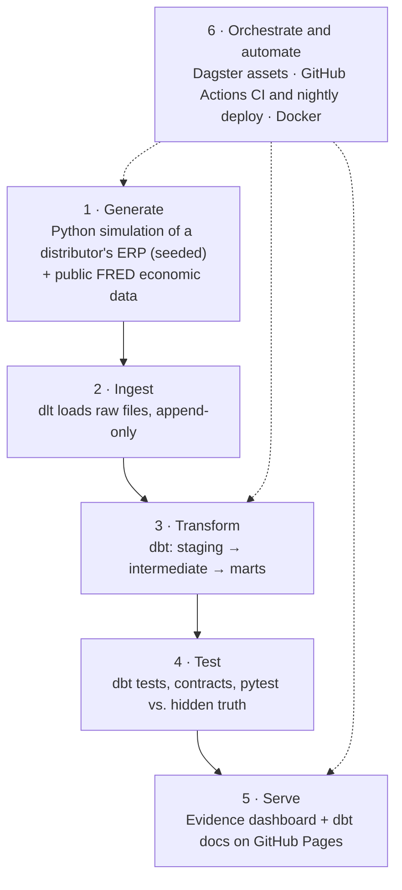

# How it works: a 2-minute overview

*For recruiters and reviewers. All data is synthetic, and this is an ideal-state design, not the
system running at Craftstones USA.*

**In one sentence:** a seeded simulation of a wholesale distributor's ERP produces messy data,
which flows through a tested ELT pipeline into a free public dashboard that answers *what to
reorder, when, how much, and where cash is tied up in dead stock*, rebuilt automatically every
night.

**Try it:** [live dashboard](https://orginalbusta.github.io/Wholesale-inventory-analytics/) ·
[what-if reorder policy](https://orginalbusta.github.io/Wholesale-inventory-analytics/what-if/) ·
[dbt docs and lineage](https://orginalbusta.github.io/Wholesale-inventory-analytics/dbt-docs/)

## The pipeline, top down

| Layer | What happens | Tools | Skills it shows |
|---|---|---|---|
| **1. Generate** | A day-by-day simulation of 3 years of a stone distributor: demand with seasonality and gem-show spikes, a naive purchasing policy, supplier delays, a stock ledger. Ten realistic data-quality problems are planted on purpose, and the simulation keeps its own "true" answers for checking the analysis | Python, pandas, numpy, Faker | Data modeling of a real business process, reproducibility (same seed, same bytes) |
| **2. Ingest** | ERP extracts and FRED series land in the warehouse unchanged. Raw tables keep every extract, so duplicates and late updates are handled where they can be tested | dlt, DuckDB (Snowflake optional) | ELT design, idempotent loads, incremental ingestion |
| **3. Transform** | 42 dbt models: staging cleans and de-duplicates; intermediate builds daily stock, true demand (including orders lost to stockouts), costs and ABC/XYZ classes; 18 marts answer the business questions (reorder points, dead stock, supplier reliability, customer segments) | dbt Core, SQL | Dimensional modeling, incremental models, snapshots (SCD2), cross-warehouse SQL |
| **4. Test** | 214 data tests and 8 unit tests in dbt, enforced contracts on every mart, source freshness; 67 pytest tests, including checks that the analysis recovers the simulation's hidden truth | dbt tests, pytest, sqlfluff, ruff | Data quality engineering, testing analytics code like software |
| **5. Serve** | A static dashboard with 8 pages, including a what-if page that recalculates every SKU's reorder policy in the browser, a page per SKU, and published dbt docs with full lineage | Evidence, DuckDB-WASM, GitHub Pages | Turning models into decisions; free, serverless hosting |
| **6. Orchestrate and automate** | Dagster models every table as an asset, with lineage from the generator to the marts. GitHub Actions runs CI on every pull request and rebuilds and redeploys the site nightly. Docker Compose runs the Dagster stack | Dagster, GitHub Actions, Docker | Orchestration, CI/CD, reproducible environments |

The same project also runs on **Snowflake**: all 18 marts came out identical to the DuckDB build,
for under 0.2 credits.

## Design decisions worth asking about

1. **DuckDB for the public site, Snowflake as a second target.** The site costs nothing to run and anyone can clone and rebuild it; the same dbt code proves it works on a cloud warehouse too.
2. **Append-only raw layer.** Messy records reach dbt intact, so fixing them is visible, tested work instead of something the loader hides.
3. **True demand includes stockouts.** Reorder points are built on what customers asked for, not on sales that were capped by empty shelves.
4. **Reorder points from two kinds of uncertainty.** Safety stock covers both demand variability and supplier lead-time variability, using measured lead times rather than optimistic supplier quotes, with a service level per ABC/XYZ class.
5. **Tests against ground truth.** The simulation knows the real supplier lead times and duplicate customers, and tests check the pipeline finds them. Several of these tests caught real bugs during the build.
6. **Analysis in the browser, verified against dbt.** The what-if page re-runs the reorder formulas client-side; a test fails CI if its numbers ever differ from the dbt model.
7. **Readable failures.** A broken model fails CI with a summary that names the model and dbt's error, proven with a deliberately broken pull request.

Every decision, with its reasoning and the alternatives considered, is logged in
[`DECISIONS.md`](DECISIONS.md).

## If you have five more minutes

- [`README.md`](../README.md): the business findings, with numbers and the mart each comes from
- [`mart_reorder_recommendations.sql`](../transform/models/marts/inventory/mart_reorder_recommendations.sql): the core reorder logic
- [`definitions.py`](../orchestration/craftstones_dagster/definitions.py): the Dagster asset graph
- [`ci.yml`](../.github/workflows/ci.yml) and [`deploy-pages.yml`](../.github/workflows/deploy-pages.yml): CI and the nightly deploy
- [`what-if.md`](../dashboard/pages/what-if.md): the interactive reorder policy page
